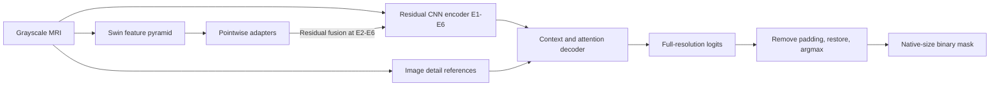

# Swin Hybrid for Brain Tumor Segmentation

Swin Hybrid combines a trainable Swin Transformer with a six-stage nnU-Net residual encoder, multiscale feature fusion, depthwise refinement, and a detail-aware decoder for **binary brain tumor segmentation on 2D MRI slices**. The project includes reproducible training, KAN and depthwise comparison models, and a native **Rust inference application**.

The retained Swin experiment completed **159 epochs**. Its final EMA checkpoint is the default deployment checkpoint. Validation selected EMA epoch **109** as the best checkpoint; both are retained. On the 860 supplied segmentation test images, weighted mIoU is **0.81146 for epoch 159** and **0.81465 for epoch 109**. The previously quoted **0.82642 is epoch 159 validation weighted mIoU**, not its test score. See [benchmark evidence](docs/benchmarks/README.md).

## Architecture

The model contains **38,801,022 parameters**, all trainable: **1,988,850** in Swin and **36,812,172** in the convolutional backbone, fusion paths, refiners, and decoder. Counts include auxiliary training heads and exclude the separate weight-EMA copy.

| Stage | Spatial size at 512 input | CNN channels | Residual blocks | Fused Swin channels |
|---|---:|---:|---:|---:|
| E1 | 512 × 512 | 32 | 1 | — |
| E2 | 256 × 256 | 64 | 3 | 24 |
| E3 | 128 × 128 | 128 | 4 | 48 |
| E4 | 64 × 64 | 256 | 6 | 96 |
| E5 | 32 × 32 | 320 | 6 | 192 |
| E6 | 16 × 16 | 320 | 6 | 384 |

- **CNN backbone:** `ResidualEncoderUNet` from `dynamic-network-architectures`, 3×3 convolutions, instance normalization, and LeakyReLU. Decoder stages each use two convolutions.
- **Swin branch:** embedding dimension 24, patch size 2×2, window size 7×7, depths `[2, 2, 2, 2]`, and attention heads `[3, 6, 12, 24]`. Projected Swin features enter E2–E6 through learned residual scales.
- **Local refinement:** residual 3×3 depthwise/pointwise blocks at E3–E6.
- **Decoder:** pooled E3–E6 context plus a global descriptor, raw-image detail paths at E1–E3, and residual Efficient Multi-Scale Attention at E3–E5 skips. Two boundary heads provide auxiliary supervision during training.
- **Output:** two logits per pixel, background and tumor. Auxiliary segmentation scales support deep supervision. Inference returns the highest-resolution logits.

The retained pretrained file was a **3D, three-channel Swin checkpoint**. Transfer sums depth and input-channel patch-embedding weights, takes the central depth plane of relative-position biases, and preserves the 8C patch-merging projection using coplanar merging. It loads 126 Swin state tensors with strict checks. Original pretraining data/modalities cannot be established from the file. The transferred encoder is then fully fine-tuned. See [the current architecture/protocol reference](docs/architecture/SWIN_HYBRID.md) and the saved `tokenizer_transfer.json`.



## Two-Stage CADx Pipeline (Screening & Segmentation)

The system provides an end-to-end Computer-Aided Diagnosis (CADx) inference pipeline combining Swin-based classification and segmentation:

- **Stage 1: Screening Gating (`src/models/swin_classifier.py`)**:
  - Architecture: **Swin Transformer V2-Tiny** (`swinv2_cr_tiny_ns_224`, ~27.57M parameters).
  - Task: Binary classification (0: Healthy / No Tumor vs 1: Tumor detected).
  - Performance: **100.0% Test Accuracy, 100.0% Sensitivity (0 False Negatives)** on the 1,000 BRISC 2025 test slices, with a latency of **3.13 ms/slice**.
  - Logic: Slices with P(Tumor) < 0.40 are identified as healthy and early-exit immediately, saving 100% of downstream segmentation computation.
- **Stage 2: Detailed Delineation (`src/models/swin_hybrid.py`)**:
  - Architecture: **Swin Hybrid** (nnU-Net + Swin Transformer 2D, 38.8M parameters).
  - Performance: **84.11% Test Dice, 74.78% Test IoU** (#1 benchmark rank).
  - Output: Pixel-level binary mask, native resolution bounding box, and tumor area percentage.
- **Unified Pipeline (`src/pipeline/cadx_pipeline.py`)**:
  ```python
  from src.pipeline import CADxPipeline

  pipeline = CADxPipeline(
      classifier_checkpoint="outputs/classifier/best_swinv2_tiny_binary.pt",
      segmenter_checkpoint="outputs/checkpoints/swin_hybrid_512_unfrozen_seed2026/best.pt",
      tokenizer_checkpoint="outputs/checkpoints/pretrained/model_swinvit.pt",
  )
  result = pipeline.predict("path/to/mri_slice.jpg")
  ```

## Project layout

```text
configs/
  dataset/                # BRISC source, local root, preprocessing, split
  model/                  # Backbone/head specifications and model options
    plans/                # nnU-Net-compatible architecture JSON fragments
  trainer/                # Optimizer, cosine schedule, epochs, EMA, stopping
  default.yaml            # Swin Hybrid
  kan.yaml
  depthwise.yaml
data/
  data/brisc2025/          # Original local dataset; excluded from Git
  processed/              # Optional derived data
notebooks/
  Kaggle_SwinV2_Classifier.ipynb # Standalone Kaggle training notebook for Swin Classifier
src/
  __init__.py
  core/                   # Registry, YAML/JSON composition, portable paths
  datasets/               # BRISC dataset and Kaggle download
  models/                 # Swin Hybrid, Swin Transformer V2-Tiny classifier, comparison architectures
  pipeline/               # Two-stage CADx end-to-end inference pipeline
  trainers/               # Training loops, loss, EMA, legacy policy utilities
  utils/                  # Metrics and evaluation utilities
scripts/                  # Download, evaluation, export, profiling, verification
outputs/
  checkpoints/<run>/      # best.pt and last.pt
  checkpoints/pretrained/ # Original Brain Swin initialization
  checkpoints/exports/    # ONNX graph and checksum/epoch metadata
  logs/<run>/             # Training history.jsonl and diagnostic logs
  runs/<run>/             # Config, splits, metrics, per-image results, status
inference/
  Cargo.toml
  Cargo.lock
  src/*.rs                # Entire inference application is written in Rust
tests/
docs/                     # Architecture, benchmark evidence, archived notes
third_party/              # Preserved reference repositories and their licenses
requirements.txt
requirements-dev.txt
pyproject.toml
train.py
```

New runs use `outputs/runs/<timestamp>_<model>` automatically, with matching directories under `outputs/checkpoints` and `outputs/logs`. An explicit `--output outputs/runs/my_run` selects a stable run name. Custom output folders outside a `runs` directory store their `checkpoints/` and `logs/` inside that folder. Existing checkpoints/history are protected from accidental fresh-run overwrite.

## Installation

Run commands from the project root. Python 3.10+ is declared; the verified local environment is **Python 3.14.2, PyTorch 2.10.0+cu130, MONAI 1.6.1, Windows, and an NVIDIA RTX 3060 12 GB**.

```powershell
python -m venv .venv
.\.venv\Scripts\Activate.ps1
# Install a CUDA-enabled PyTorch build using the official selector first.
python -m pip install -r requirements.txt
python -m pip install -e . --no-deps
# Development, test, and ONNX export dependencies:
python -m pip install -r requirements-dev.txt
```

Use the [official PyTorch installation selector](https://pytorch.org/get-started/locally/) for your operating system and CUDA environment. The Windows launchers select `.venv/Scripts/python.exe` when available and propagate the training exit code.

## Dataset

Source: [BRISC 2025 on Kaggle](https://www.kaggle.com/datasets/briscdataset/brisc2025). The existing dataset has been moved to `data/data/brisc2025` without altering its images or masks. When it is absent, the default configuration downloads it with [KaggleHub](https://github.com/Kaggle/kagglehub). Dataset access may require Kaggle authentication/consent.

```powershell
python -m scripts.download_data
python train.py --print-config
```

Expected segmentation layout:

```text
data/data/brisc2025/segmentation_task/
  train/images/   train/masks/
  test/images/    test/masks/
```

There are **3,933 paired training images** and **860 paired test images**. A seed-2026 split stratified by tumor type and imaging plane gives **3,146 fitting / 787 validation** images. These are slice-level splits; patient IDs are unavailable. The classification task is separate; its 140 no-tumor test images are excluded from the headline segmentation comparison.

Images become grayscale, are resized with aspect-preserving bilinear interpolation and centered padding, and are normalized using the nonzero pixels of each slice. Foreground masks use `mask >= 128`. Padded target pixels are ignored. Evaluation removes padding, restores continuous logits to native image size, then applies argmax. Tumor-type scores group slices by filename labels; the network predicts a single binary tumor class.

## Training

```powershell
# Default Swin Hybrid experiment, with automatic timestamped output
python train.py
# Equivalent Windows launcher
.\run_hybrid.bat

# Comparison models
python train.py --model kan
python train.py --model depthwise

# Explicit configuration and CLI overrides
python train.py --config configs/default.yaml --batch-size 1 --effective-batch 16
python train.py --config configs/kan.yaml --epochs 100 --workers 4

# Two-epoch functional check, including delayed EMA at epoch 2
python train.py --smoke-test --size 64 --batch-size 1 --effective-batch 2 --ema-start 2

# Resume the retained Swin run with its original training budget/protocol
python train.py --resume outputs/checkpoints/swin_hybrid_512_unfrozen_seed2026/last.pt
```

The retained Swin run has already reached its early-stopping condition. Resuming restores its state and evaluates the selected checkpoint; it does not extend the original budget or reset early stopping. Fresh experiments receive new timestamped destinations. Resume options affecting the protocol must match the checkpoint. To resume the historical KAN run, preserve its original 100-epoch budget, four workers and weighted-mIoU selection:

```powershell
python train.py --model kan --epochs 100 --workers 4 --selection-metric weighted-miou --resume outputs/checkpoints/kan_20261101_090911_204358/last.pt
```

The configuration loader supports `.yaml`, `.yml`, and `.json`, with relative section includes under `defaults`. CLI options override configuration values. Dataset split seed/fraction live in `configs/dataset`; optimizer, LR schedule and training controls live in `configs/trainer`. Model YAML documents the fixed checkpoint architecture; supported tunable model options live under `model.options`. Changing the audited Swin topology requires corresponding model code and a fresh checkpoint.

| Swin training setting | Value |
|---|---|
| Input / physical / effective batch | 512×512 / 2 / 16 |
| Optimizer | AdamW, weight decay 0.0001, gradient clipping 12 |
| Initial CNN / Swin LR | 0.0003 / 0.00009 |
| LR schedule | Shared cosine multiplier to 1% of initial LR |
| Maximum epochs | 300; actual completed epochs: 159 |
| Weight EMA | Starts at epoch 20, decay ceiling 0.9995 |
| Early stopping | After epoch 100, patience 50, minimum delta 0.0001 |
| Checkpoint selection | Validation Glioma mean foreground IoU |
| Tumor sampling weights | Glioma 2.0, Meningioma 1.0, Pituitary 1.3 |
| Augmentation / precision | Robust augmentation, all tumor types / CUDA AMP |
| Reserved-memory budget | 9 decimal GB, measured through PyTorch |

The deep-supervision objective is `alpha * Dice + beta * Focal + gamma * Boundary`. For progress `p = clamp((epoch - 1) / 149, 0, 1)`, alpha is 1, beta is `0.5 + 0.5p`, and gamma is `0.01 + 0.49p`. Losses ignore padding. Weight EMA is separate from Efficient Multi-Scale Attention and advances only after successful optimizer updates. Resume checkpoints include model, EMA, optimizer, scheduler, AMP scaler, splits, RNG, early stopping, and the current history row.

## Benchmark results

All rows use the same **860 segmentation test images**, native-resolution masks, no test-time augmentation, and no component filtering. Weighted mIoU is the mean foreground IoU per image, equivalently the tumor-type means weighted by their image counts. Dice is also an image mean.

| Model / weights | Epoch | Input | Parameters | Weighted mIoU | Glioma mIoU | Meningioma mIoU | Pituitary mIoU | Dice |
|---|---:|---:|---:|---:|---:|---:|---:|---:|
| Swin Hybrid, validation-selected EMA | 109 | 512² | 38,801,022 | **0.81465** | **0.70659** | **0.90876** | **0.81015** | **0.87959** |
| Swin Hybrid, final EMA / default Rust export | 159 | 512² | 38,801,022 | 0.81146 | 0.70489 | 0.90494 | 0.80634 | 0.87722 |
| KAN, validation-selected EMA | 54 | 256² | 8,916,618 | 0.79530 | 0.66709 | 0.89807 | 0.79902 | 0.86515 |
| nnU-Net v2 + depthwise 7×7, validation-selected EMA | 23 | 256² | 8,804,746 | 0.79378 | 0.66223 | 0.89489 | 0.80202 | 0.86580 |

The depthwise row is this project's custom 2D residual nnU-Net architecture with depthwise convolution. It does **not** represent an independent run of the full official nnU-Net v2 automatic planning, cross-validation and ensemble pipeline. Swin uses higher resolution, more parameters, a different loss/training budget, and pretrained weights; these results are experiment comparisons rather than controlled single-component ablations. KAN selects by validation weighted mIoU; Swin and depthwise select by validation Glioma mIoU.

| Model | Supported-operator GFLOPs | GPU forward median, ms/image | Training peak reserved, MiB |
|---|---:|---:|---:|
| Swin Hybrid epoch 109 | 237.777 | 49.814 | 3,088 |
| Swin Hybrid epoch 159 | 237.777 | 49.599 | 3,088 |
| KAN | 32.112 | 26.036 | 8,322 |
| nnU-Net v2 + depthwise 7×7 | 31.903 | 11.323 | 6,064 |

GPU timing is **PyTorch CUDA AMP, RTX 3060, batch 1, warmed-up synchronized forward passes**, excluding preprocessing, I/O, restoration and metrics. It is not Rust CPU latency. KAN/epoch-159 reports use 3 warmups and 20 iterations; original depthwise uses 10 warmups and 50 iterations. FLOPs count supported PyTorch operations with multiply-add = 2 and exclude unregistered operations such as normalization and KAN basis exponentiation. VRAM excludes CUDA context and other processes. Raw reports, per-image CSVs and protocol details are linked in [benchmark evidence](docs/benchmarks/README.md).

HD95/ASSD are in native pixels, since physical spacing is unavailable. NSD uses a two-pixel tolerance. One-empty-mask distances remain infinite; supplementary finite-only summaries do not replace the headline metrics.

## Rust inference

All inference application source files are Rust. The Python **export utility lives in `scripts/`**, alongside training tooling. It converts the checkpoint's saved evaluation weights to ONNX once; the Rust application then runs without Python or PyTorch. The default artifact uses **EMA epoch 159**.

```powershell
# Already generated locally; run once on a fresh checkout with retained weights
python -m scripts.export_swin_hybrid

# Build with stable Rust; tested with rustc/cargo 1.96.1
cargo build --release --locked --manifest-path inference/Cargo.toml

# During setup, locate the CPU ONNX Runtime library installed with requirements-dev
$ortDll = python -c "import pathlib,onnxruntime; print(pathlib.Path(onnxruntime.__file__).parent/'capi'/'onnxruntime.dll')"

.\inference\target\release\brain-inference.exe --input data/data/brisc2025/segmentation_task/test/images/brisc2025_test_00001_gl_ax_t1.jpg --output outputs/runs/predictions_example --ort-dylib $ortDll
```

`--input` accepts one JPEG/PNG or a flat directory of images. Masks are native-size PNGs with 0 for background and 255 for tumor. Per-image JSON records the model, epoch, weights, dimensions, foreground count and timing. The application checks the ONNX SHA-256 against its adjacent JSON metadata and rejects existing output filenames. Move the executable, ONNX/JSON pair and a compatible ONNX Runtime library to another machine for deployment. `--ort-dylib` also accepts `libonnxruntime.so`/`.dylib`; alternatively configure `ORT_DYLIB_PATH`.

To deploy the validation-selected checkpoint instead:

```powershell
python -m scripts.export_swin_hybrid --checkpoint outputs/checkpoints/swin_hybrid_512_unfrozen_seed2026/best.pt --output outputs/checkpoints/exports/swin_hybrid_epoch109.onnx
# Pass --model outputs/checkpoints/exports/swin_hybrid_epoch109.onnx to the Rust executable.
```

The export fixes input shape to `[1, 1, 512, 512]` and outputs float32 logits `[1, 2, 512, 512]`. Equivalent fixed pooling replaces adaptive context pooling only in the export copy. The exporter checks ONNX validity and real-image logit parity. The verified export had maximum absolute logit error **0.0004573** and **100% argmax agreement** against float32 PyTorch on that image.

Native Rust preprocessing/restoration was checked on five PNG cases, including non-square upsampling/downsampling: maximum input error was below **5e-7** and restored masks matched exactly. A JPEG case matched **99.9981%** of native mask pixels; independent JPEG decoders introduce rounding near zero before nonzero-pixel normalization. This functional check is separate from the 860-image PyTorch accuracy benchmark. See [parity results](outputs/runs/rust_parity_verified/parity.json).

CPU inference is verified using ONNX Runtime **1.24.4**. CUDA inference is available with `cargo build --release --features cuda --manifest-path inference/Cargo.toml` and `--device cuda`; its build was checked, but its runtime was not measured here. Supply an ONNX Runtime GPU build and compatible CUDA/cuDNN libraries following the [official CUDA provider compatibility guide](https://onnxruntime.ai/docs/execution-providers/CUDA-ExecutionProvider.html).

## Recommended hardware

For the documented training configuration, use an **NVIDIA CUDA GPU with 12 GB VRAM or more**; the tested reference is an [RTX 3060 12 GB](https://www.nvidia.com/en-us/geforce/graphics-cards/30-series/rtx-3060-3060ti/). This is a recommendation based on the retained experiment and measured memory, not a minimum proven for every environment. Start Swin with physical batch 2/effective batch 16; reduce the physical batch to 1 if memory is constrained. KAN's retained batch-32 training reserved substantially more memory than this Swin configuration. Keep system RAM available for workers and checkpoint loading; reduce workers on constrained Windows hosts. CPU Rust inference is supported for deployment without a CUDA GPU.

## Evaluation and verification

```powershell
# Re-evaluate any retained model on its saved test membership; choose a fresh output
python -m scripts.evaluate_checkpoint --checkpoint outputs/checkpoints/swin_hybrid_512_unfrozen_seed2026/last.pt --output outputs/runs/evaluate_epoch159 --benchmark
python -m scripts.evaluate_checkpoint --checkpoint outputs/checkpoints/kan_20261101_090911_204358/best.pt --output outputs/runs/evaluate_kan --benchmark
python -m scripts.evaluate_checkpoint --checkpoint outputs/checkpoints/depthwise7_seed2026/best.pt --output outputs/runs/evaluate_depthwise --benchmark

python -m pytest -q
cargo test --locked --manifest-path inference/Cargo.toml
python -m scripts.verify_rust_inference --output outputs/runs/rust_parity_repeat
```

Reorganization verification passed **129 Python tests**, **3 Rust tests**, two CUDA Swin smoke epochs, a separate depthwise smoke run, and Swin checkpoint resume. Original experiment checkpoint bytes were preserved and verified by SHA-256. Smoke model binaries were removed after verification. The checkpoint inventory is [outputs/checkpoints/manifest.json](outputs/checkpoints/manifest.json); cleanup details and validation logs are under `outputs/logs/reorganization`.

Retained experiment families are **Swin Hybrid 512/unfrozen**, **KAN 20261101**, and the highest-scoring **depthwise 7×7**. Verification, KAN two-way, BiRef, Swin 300/frozen, epoch-58 and lower-scoring depthwise checkpoint binaries were removed. Compact historical reports remain under `docs/benchmarks/historical`; prior architecture notes are explicitly archived. Original checkpoint/config provenance may contain the former paths; current loaders resolve the relocated data and pretrained initialization without rewriting the saved weights.

## Team and citation

**Members:** Tran Manh Hung, Nguyen Phuoc Toan, Nguyen Huu Tuan Phat.
**Mentor:** Hoang Thi Kieu Anh.

If you use this code, architecture or checkpoints, please cite this project using [CITATION.cff](CITATION.cff), and cite the BRISC dataset and upstream methods as appropriate. This is a software citation; no paper DOI or repository URL has been assigned here.

```bibtex
@software{tran2026swinhybrid,
  author = {Tran, Manh Hung and Nguyen, Phuoc Toan and Nguyen, Huu Tuan Phat},
  title = {Swin Hybrid for Brain Tumor Segmentation},
  year = {2026},
  version = {0.1.0},
  note = {Project supervised by Hoang Thi Kieu Anh}
}
```

References and acknowledgments: [Swin Transformer](https://arxiv.org/abs/2103.14030), [nnU-Net](https://github.com/MIC-DKFZ/nnUNet), [MONAI](https://github.com/Project-MONAI/MONAI), [Efficient Multi-Scale Attention](https://arxiv.org/abs/2305.13563), [surface-distance](https://github.com/google-deepmind/surface-distance), and [BRISC 2025](https://www.kaggle.com/datasets/briscdataset/brisc2025). Reference repositories retain their own licenses under `third_party/`.
